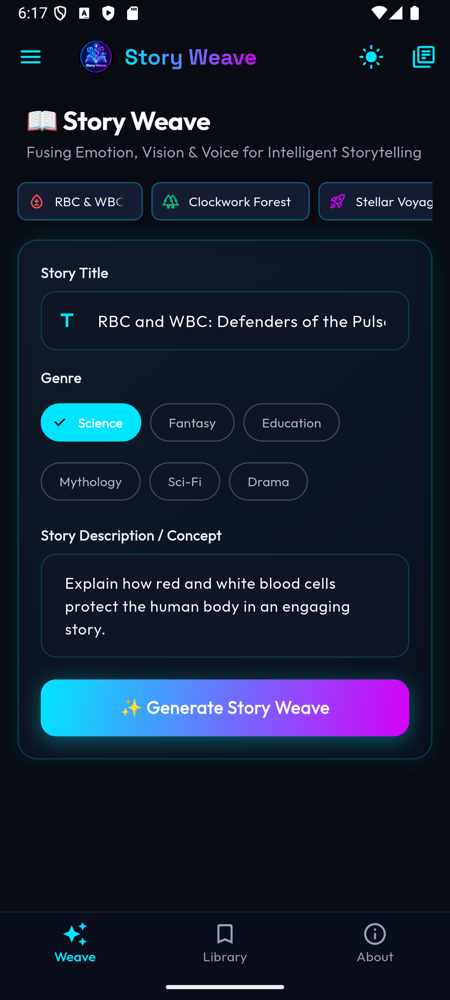
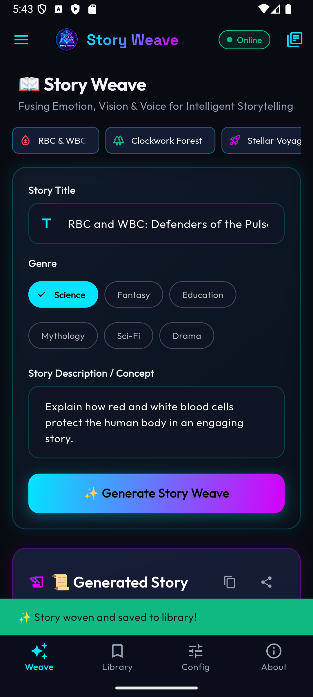
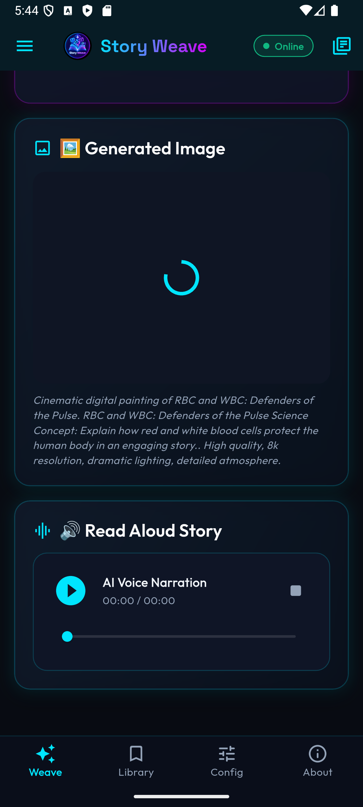
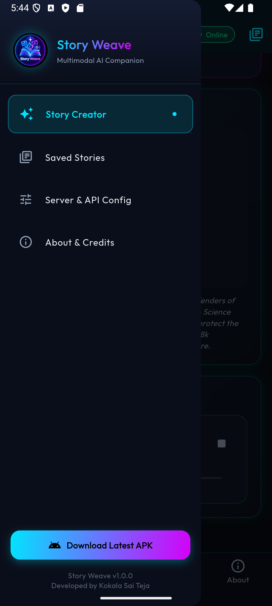
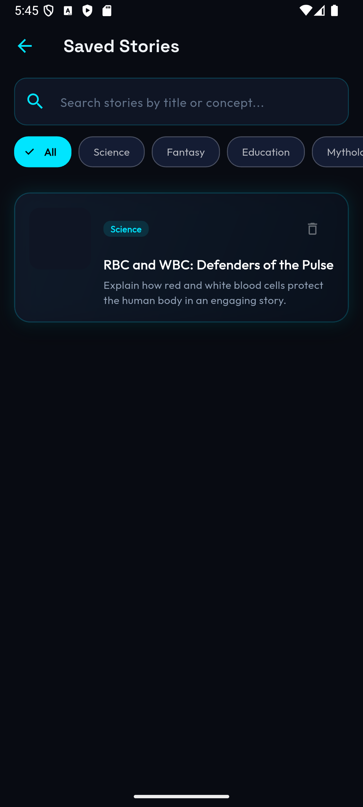
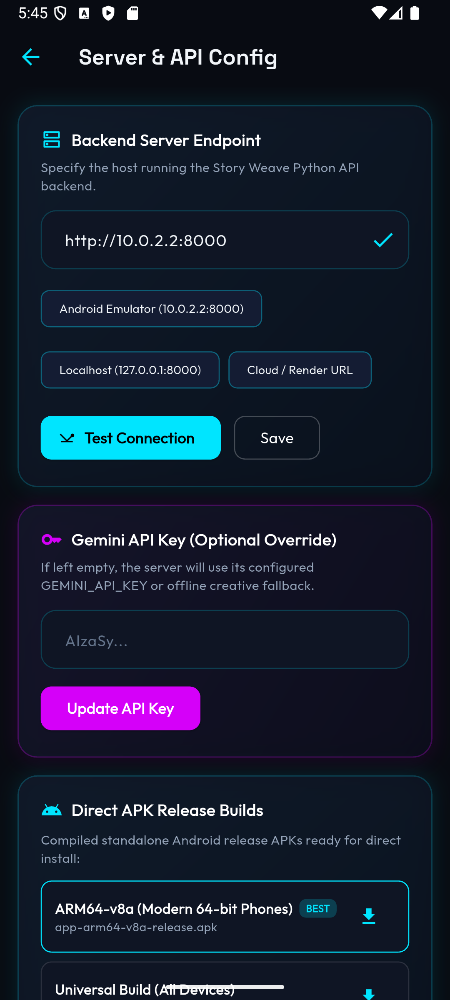
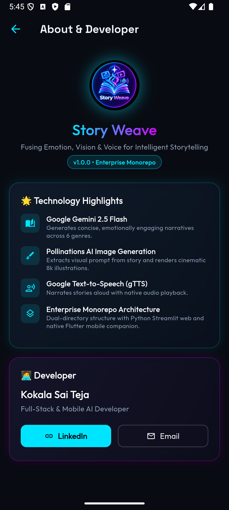

# 📱 Story Weave — Companion Flutter Android Mobile App

**Story Weave Mobile** is the native Android companion application for Story Weave. Designed to replicate the exact liquid-glass dark neon cyber aesthetic of the Streamlit website, it provides intelligent storytelling on Android devices with persistent local caching, native audio narration, and offline resiliency.

---

## 🌟 Mobile Highlights & Capabilities

- **1:1 Visual Parity with Website**: Deep midnight background (`#080B12`), neon cyan (`#00E5FF`) and electric magenta (`#D500F9`) accents, frosted glass containers, and responsive typography (Outfit & Space Grotesk).
- **Adaptive App Icon**: Custom high-resolution neon logo configured via `flutter_launcher_icons` with adaptive icon layers for seamless masking without white borders.
- **Dynamic Connection & Wake Monitoring**: Real-time status indicator (Online / Cold Start Waking Up / Offline) with automatic retry and support for free-tier cloud cold starts.
- **Persistent Story Library**: Automatic saving of woven narratives to local device storage with search, genre filters, and one-tap sharing.
- **Native Audio Narration**: Built with `audioplayers` for smooth playback, progress scrubbing, and volume control.
- **Direct APK In-App Downloader**: Integrated update center allowing users to download and install newer ABI builds directly.

---

## 📸 Mobile Walkthrough Screenshots

| 1. Main Story Weave Creator | 2. Narrative Output | 3. AI Illustration & Voice | 4. Active Drawer Navigation |
|:---:|:---:|:---:|:---:|
|  |  |  |  |

| 5. Saved Story Library | 6. Server & API Config | 7. About & Developer |
|:---:|:---:|:---:|
|  |  |  |

---

## 📦 Standalone Release APK Builds

The mobile application is optimized with `--split-per-abi` to ensure lightweight installation footprints:

| Build Artifact | Target Architecture | Target Devices | File Size | Status |
|:---|:---|:---|:---:|:---:|
| `app-arm64-v8a-release.apk` | 64-bit ARM (`arm64-v8a`) | Modern Android smartphones (Recommended) | **21.08 MB** | ✅ Available |
| `app-armeabi-v7a-release.apk` | 32-bit ARM (`armeabi-v7a`) | Legacy budget Android devices | **18.60 MB** | ✅ Available |
| `app-x86_64-release.apk` | 64-bit x86 (`x86_64`) | Android Studio Emulators & ChromeOS | **22.50 MB** | ✅ Available |
| `app-release.apk` | Multi-Architecture Universal | Universal fat APK for all Android systems | **54.10 MB** | ✅ Available |

---

## 🚀 Setup & Build Instructions

```bash
# 1. Navigate to the mobile directory
cd Story_Weave_Mobile_app

# 2. Fetch Flutter dependencies
flutter pub get

# 3. Generate adaptive app icons
flutter pub run flutter_launcher_icons

# 4. Run the app in development mode on connected emulator/device
flutter run

# 5. Build optimized standalone split-per-ABI APKs:
flutter build apk --split-per-abi

# 6. Build universal fat APK:
flutter build apk
```
