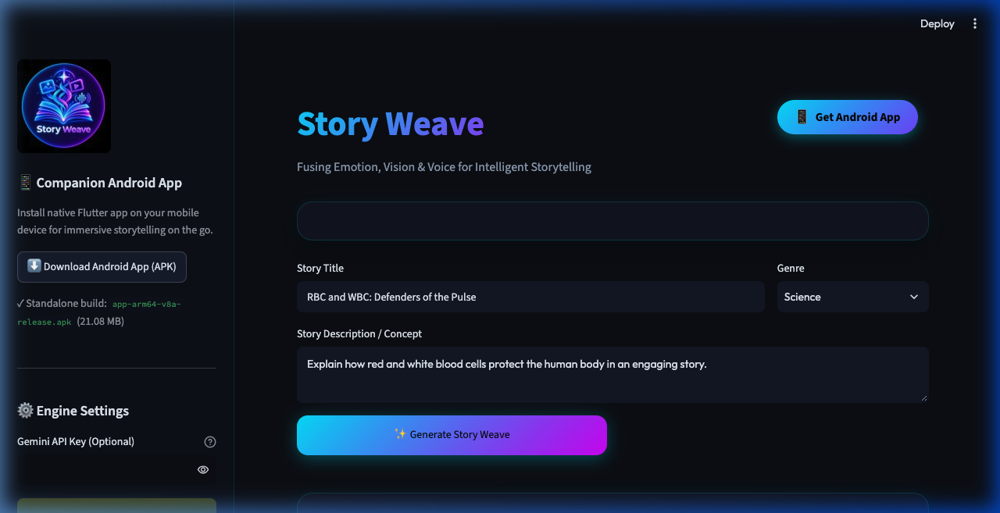
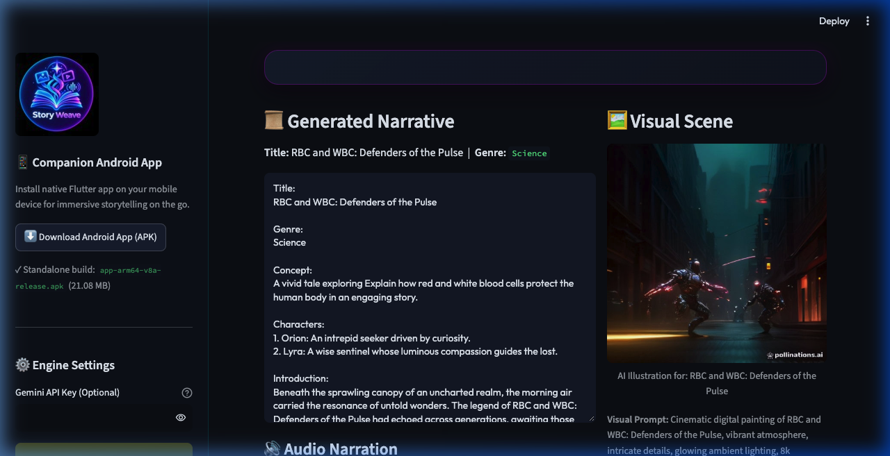
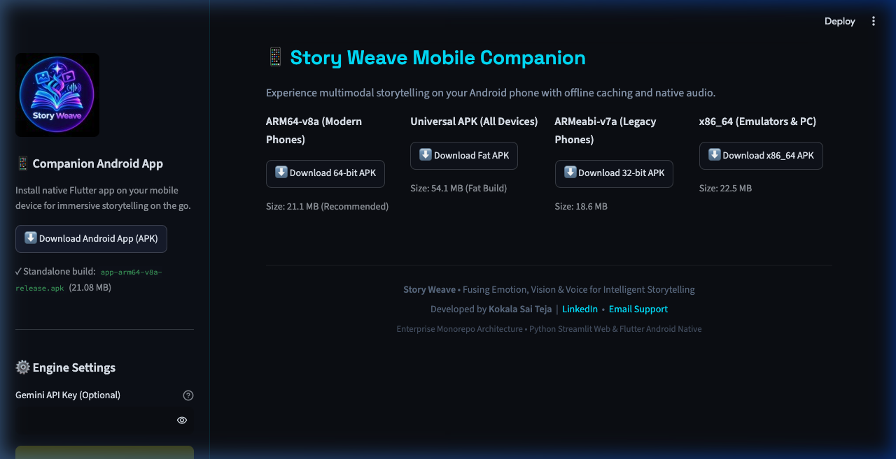

# 🌐 Story Weave — Web Application & Backend API

[](https://ai-story-weave.streamlit.app/)

- 🌐 **Live Demo Web Application**: [https://ai-story-weave.streamlit.app/](https://ai-story-weave.streamlit.app/)

**Story Weave Web** is the web tier and REST API distribution hub of the Story Weave enterprise monorepo. It features a modern Python Streamlit interface infused with custom liquid-glass / dark neon cyber styling, paired with a high-performance FastAPI service for mobile synchronization and direct APK distribution.

---

## 🌟 Key Features

1. **Liquid-Glass Modern UI**: Built with Streamlit, custom CSS glassmorphism, responsive container alignment, and neon glow accents.
2. **Multimodal AI Pipeline**:
   - **Gemini 2.5 Flash**: Crafts concise, emotionally engaging narratives (Introduction, Story, Conclusion).
   - **Pollinations AI**: Visual scene extraction rendering 8k cinematic illustrations.
   - **Google Text-to-Speech (gTTS)**: Synthesizes narration audio with streaming playback and MP3 download.
3. **Integrated APK Distribution Hub**:
   - Direct header & sidebar **"Download Android App"** action buttons.
   - Standalone download grid for all 4 Android architectures (`arm64-v8a`, `universal`, `armeabi-v7a`, `x86_64`).
4. **FastAPI Companion Backend**:
   - `/health`: Instant latency and engine status check.
   - `/api/generate`: REST pipeline for story, image, and voice.
   - `/download-apk/{filename}`: High-speed chunked streaming with `application/vnd.android.package-archive` MIME headers.

---

## 💻 Walkthrough Screenshots

### 1. Home Interface & Input Controls


### 2. Generated Story, AI Illustration & Audio Narration


### 3. Direct Android APK Download Center


---

## 🚀 Quickstart & Fresh Clone Instructions

```bash
# 1. Navigate to the web directory
cd Story_Weave_Web

# 2. Create and activate a isolated Python virtual environment
python3 -m venv venv
source venv/bin/activate

# 3. Install web & API requirements
pip install -r requirements.txt

# 4. Optional: Configure Gemini API Key
# Either export as environment variable:
export GEMINI_API_KEY="your_gemini_api_key_here"
# Or edit .streamlit/secrets.toml

# 5. Launch the Streamlit Web Application (Port 8501)
streamlit run app.py --server.port 8501

# 6. Launch the FastAPI Backend Service (Port 8000) in a separate terminal:
uvicorn api:app --host 0.0.0.0 --port 8000 --reload
```

---

## 📂 Directory Layout

```
Story_Weave_Web/
├── README.md              # Web-specific setup and documentation
├── requirements.txt       # Web package dependencies
├── app.py                 # Streamlit web frontend
├── api.py                 # FastAPI companion service & APK server
├── .streamlit/
│   ├── config.toml        # Dark theme and server config
│   └── secrets.toml       # API key configuration
├── media/                 # Release APK builds and synthesized audio
│   ├── app-arm64-v8a-release.apk
│   ├── app-armeabi-v7a-release.apk
│   ├── app-x86_64-release.apk
│   └── app-release.apk
├── static/                # High-res logos, favicons, and branding
│   ├── logo.png
│   ├── favicon.png
│   └── favicon.ico
└── screenshots/           # Laptop walkthrough screenshots (1280x800)
```
